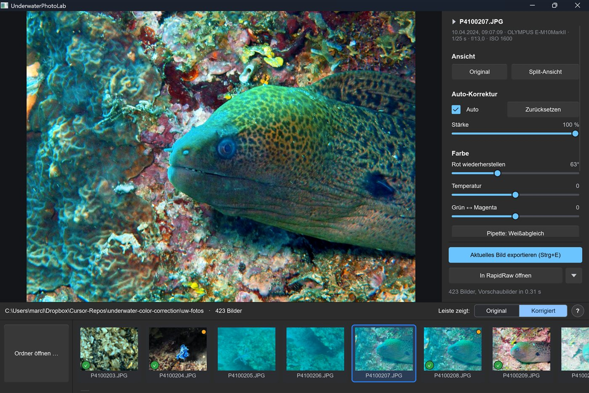
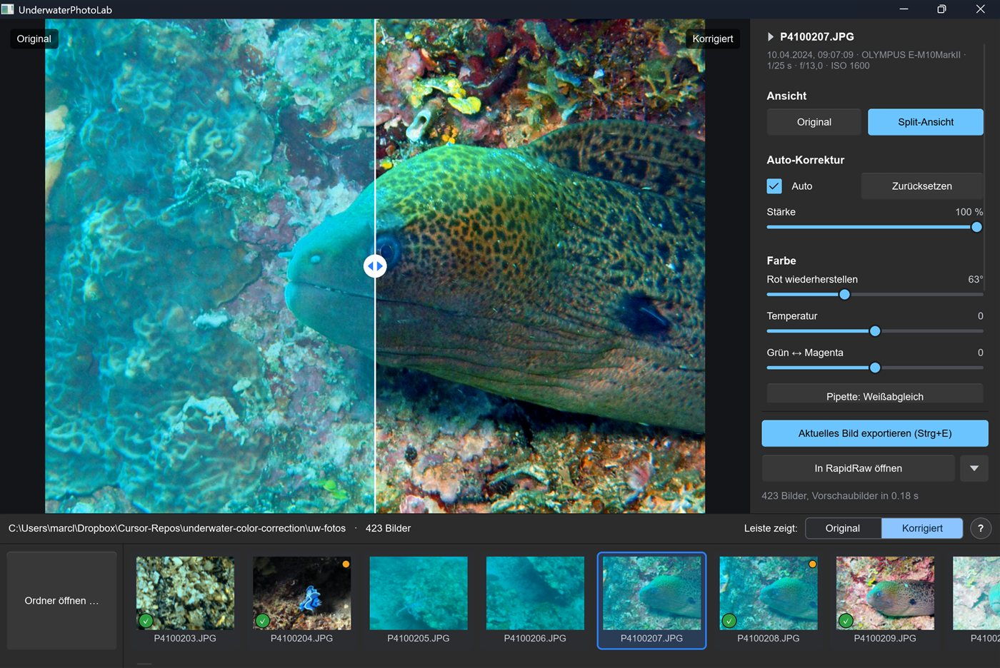
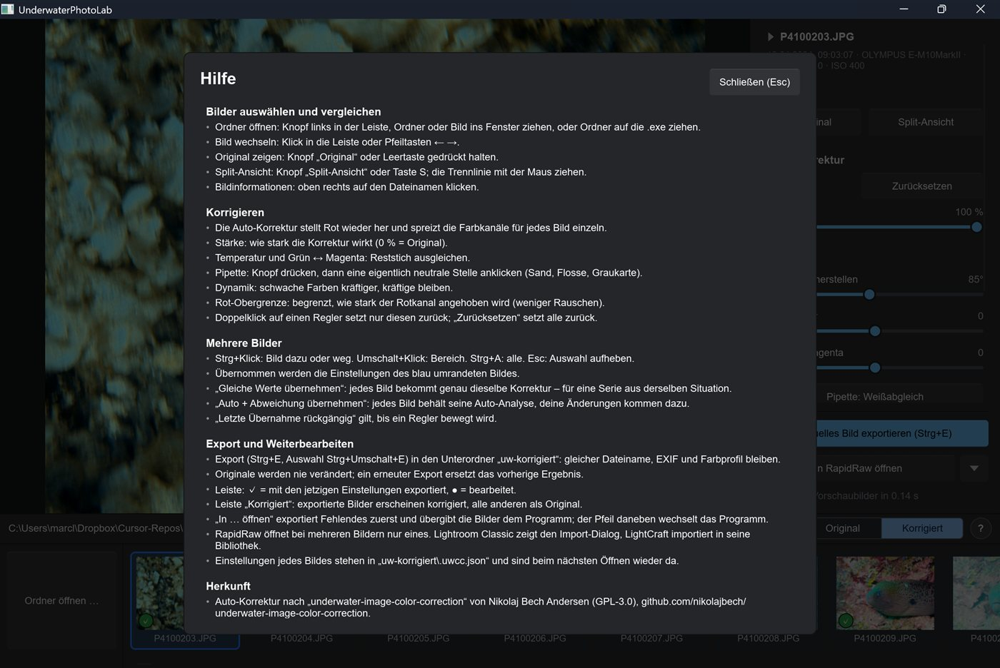

# UnderwaterPhotoLab – Hilfe

Farbkorrektur für Unterwasserfotos (JPG). Die korrigierten Bilder landen im Unterordner
`uw-korrigiert` und lassen sich von dort in RapidRaw, PhotoCraft, Lightroom & Co. weiterbearbeiten.
Im Programm öffnet **F1** oder der Knopf **„?“** dieselbe Hilfe.

## Bilder auswählen und vergleichen

- **Ordner öffnen:** Knopf links in der Bildleiste, einen Ordner oder ein Bild ins Fenster ziehen, oder einen Ordner auf `UnderwaterPhotoLab.exe` ziehen. Beim nächsten Start öffnet sich der zuletzt geöffnete Ordner wieder.
- **Bild wechseln:** Klick in die Leiste oder Pfeiltasten ← →.
- **Original zeigen:** Knopf „Original“ oder Leertaste gedrückt halten (der Knopf wird dabei blau).
- **Split-Ansicht:** Knopf „Split-Ansicht“ oder Taste **S**; die Trennlinie mit der Maus ziehen.
- **Zoom:** Doppelklick ins Bild (100 % an dieser Stelle) oder Taste **Z** (100 % in der Mitte). **Mausrad** oder am Touchpad bzw. Touchbildschirm **zwei Finger auf- und zuziehen** zoomt stufenlos bis 400 %; die Stelle unter dem Mauszeiger bleibt stehen. **Ziehen** mit der Maus oder **zwei Finger schieben** am Touchpad verschiebt den Ausschnitt; die Trennlinie der Split-Ansicht greift man direkt an der Linie. Doppelklick, **Z** oder **Esc** zurück zur ganzen Ansicht. So lassen sich Schärfe, Rauschen und Schwebeteilchen beurteilen.
- **Bildinformationen:** oben rechts auf den Dateinamen klicken (Aufnahme, Kamera, Objektiv, Belichtung, Auto-Analyse …).
- **Leiste „Original | Korrigiert“:** bei „Korrigiert“ erscheinen exportierte Bilder korrigiert, alle anderen als Original – so sieht man, wo noch etwas zu tun ist.

## Korrigieren

- Die **Auto-Korrektur** stellt Rot wieder her und spreizt die Farbkanäle, für jedes Bild einzeln.
- **Histogramm** oben rechts: Rot-, Grün- und Blaukanal des korrigierten Bildes. Die Dreiecke leuchten, wenn Tiefen (links) oder Lichter (rechts) beschnitten werden, in der Farbe der betroffenen Kanäle.
- **Klick auf ein Dreieck oder Taste J:** beschnittene Stellen im Bild markieren (rot = Lichter, blau = Tiefen).
- **Stärke:** wie stark die Korrektur wirkt (0 % = Original).
- **Rot wiederherstellen:** wie viel Grün/Blau in den Rotkanal zurückgemischt wird.
- **Temperatur** und **Grün ↔ Magenta:** Reststich ausgleichen.
- **Pipette:** Knopf drücken, dann eine eigentlich neutrale Stelle anklicken (Sand, Flosse, Graukarte).
- **Dynamik:** schwache Farben kräftiger, kräftige bleiben.
- **Rot-Obergrenze:** begrenzt, wie stark der Rotkanal angehoben wird (weniger Rauschen).
- **Doppelklick auf einen Regler** setzt nur diesen zurück; „Zurücksetzen“ setzt alle zurück.

## Mehrere Bilder

- **Strg+Klick:** Bild dazu oder weg. **Umschalt+Klick:** Bereich. **Strg+A:** alle. **Esc:** Auswahl aufheben.
- Übernommen werden die Einstellungen des **blau umrandeten** Bildes.
- **„Gleiche Werte übernehmen“:** jedes Bild bekommt genau dieselbe Korrektur – für eine Serie aus derselben Situation.
- **„Auto + Abweichung übernehmen“:** jedes Bild behält seine eigene Auto-Analyse, deine Änderungen kommen dazu.
- **„Letzte Übernahme rückgängig“** gilt, bis ein Regler bewegt wird.

## Export und Weiterbearbeiten

- **Export:** Strg+E (aktuelles Bild), Strg+Umschalt+E (Auswahl). Ziel ist immer der Unterordner `uw-korrigiert` neben den Originalen, mit gleichem Dateinamen; EXIF, Farbprofil und Ausrichtung bleiben erhalten, das eingebettete Vorschaubild wird aus dem korrigierten Bild neu erzeugt.
- **Originale werden nie verändert;** ein erneuter Export ersetzt das vorherige Ergebnis.
- In der Leiste: **✓** = mit den jetzigen Einstellungen exportiert, **●** = bearbeitet.
- **„In … öffnen“** exportiert Fehlendes oder Veraltetes zuerst und übergibt die Bilder dem Programm. Der Pfeil daneben wechselt das Programm; nicht gefundene Programme lassen sich dort suchen, eigene über „Anderes Programm hinzufügen …“.
  - RapidRaw öffnet bei mehreren Bildern nur eines.
  - Lightroom Classic zeigt den Import-Dialog, LightCraft importiert in seine Bibliothek.
  - „Öffnen mit …“: Windows fragt nach dem Programm (nur für ein Bild).
- Die Einstellungen jedes Bildes stehen in `uw-korrigiert\.uwcc.json` und sind beim nächsten Öffnen des Ordners wieder da.
- Programmeinstellungen (JPG-Qualität, Leistenansicht, Programme) stehen in `%APPDATA%\UnderwaterPhotoLab\config.json`; in `programs` lassen sich die Startargumente anpassen (`{files}` = exportierte Dateien, `{folder}` = Ordner `uw-korrigiert`).

## Herkunft

Die Auto-Korrektur folgt „underwater-image-color-correction“ von Nikolaj Bech Andersen
(<https://github.com/nikolajbech/underwater-image-color-correction>, GPL-3.0). UnderwaterPhotoLab steht
deshalb ebenfalls unter der GPL-3.0 (siehe `LICENSE`).
